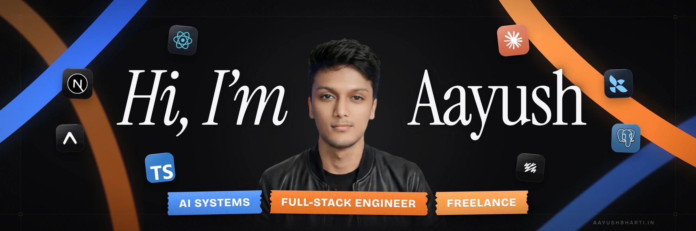

[](https://aayushbharti.in)
[](https://aayushbharti.in)

  <a href="https://aayushbharti.in/">
    
  </a>

<h3>I build production web apps end to end, from the interface to the AI systems behind it.</h3>

- 🌱 Currently learning **DevOps** and **system design**
- 👨‍💻 Selected work → [aayushbharti.in/projects](https://aayushbharti.in/projects)
- 🤝 Taking on freelance projects, open to full-time roles → [get in touch](https://aayushbharti.in/contact)

<br/>

✍️ &ensp; <b>Latest writing</b>
<br>

<a href="https://aayushbharti.in/" target="_blank"></a>

<!-- BLOG-POST-LIST:START -->
- [What's New in Next.js 16.4](https://aayushbharti.in/blog/nextjs-16-4-whats-new)
- [How to Optimize a Next.js Web App](https://aayushbharti.in/blog/how-to-optimize-a-nextjs-web-app)
- [Every Tool in My Terminal-First Dev Setup](https://aayushbharti.in/blog/terminal-first-dev-setup)
- [Build a Blog with Next.js and MDX from Scratch](https://aayushbharti.in/blog/build-a-blog-with-nextjs-and-mdx)
- [What I'd Tell Myself Before Learning to Code](https://aayushbharti.in/blog/what-i-wish-i-knew-before-learning-to-code)<!-- BLOG-POST-LIST:END -->

[All posts →](https://aayushbharti.in/blog)<br clear="right"/>

<!-- Things I code with (hidden)
 &ensp; <b> Things I code with</b>
<br>

<p align="left">
[](https://aayushbharti.in)
</p>
-->
<!-- no <br/> here: the Octocat's overhang above already spaces this heading -->
📊 &ensp; <b>Weekly development breakdown</b>
<br>

<!--START_SECTION:waka-->

```txt
Total Time: 81 hrs 57 mins

TypeScript     37 hrs 34 mins        ⣿⣿⣿⣿⣿⣿⣿⣿⣿⣿⣿⣦⣀⣀⣀⣀⣀⣀⣀⣀⣀⣀⣀⣀⣀   45.85 %
Other          32 hrs 48 mins        ⣿⣿⣿⣿⣿⣿⣿⣿⣿⣿⣀⣀⣀⣀⣀⣀⣀⣀⣀⣀⣀⣀⣀⣀⣀   40.03 %
JavaScript     3 hrs 40 mins         ⣿⣄⣀⣀⣀⣀⣀⣀⣀⣀⣀⣀⣀⣀⣀⣀⣀⣀⣀⣀⣀⣀⣀⣀⣀   04.49 %
Markdown       2 hrs 49 mins         ⣷⣀⣀⣀⣀⣀⣀⣀⣀⣀⣀⣀⣀⣀⣀⣀⣀⣀⣀⣀⣀⣀⣀⣀⣀   03.46 %
Python         1 hr 4 mins           ⣤⣀⣀⣀⣀⣀⣀⣀⣀⣀⣀⣀⣀⣀⣀⣀⣀⣀⣀⣀⣀⣀⣀⣀⣀   01.30 %
```

<!--END_SECTION:waka-->

<br/>

<details>
  <summary>
    📈 &ensp; <b>Stats overview</b>
  </summary>

  <br>

  <div align="center">
    <a href="https://aayushbharti.in">
      <picture>
        <source media="(prefers-color-scheme: dark)" srcset="https://github-readme-stats-salesp07.vercel.app/api/top-langs/?username=aayushbharti&langs_count=8&layout=compact&theme=dark&border_radius=10&hide_border=true" />
        
      </picture>
    </a>
    <a href="https://aayushbharti.in">
      <picture>
        <source media="(prefers-color-scheme: dark)" srcset="https://github-readme-stats-salesp07.vercel.app/api?username=aayushbharti&count_private=true&show_icons=true&theme=dark&rank_icon=github&hide_border=true&border_radius=10&include_all_commits=true" />
        
      </picture>
    </a>
    <br/>
    <a href="https://aayushbharti.in">
      <picture>
        <source media="(prefers-color-scheme: dark)" srcset="https://github-readme-streak-stats-salesp07.vercel.app/?user=aayushbharti&count_private=true&theme=dark&hide_border=true&border_radius=10" />
        
      </picture>
    </a>
  </div>
</details>
